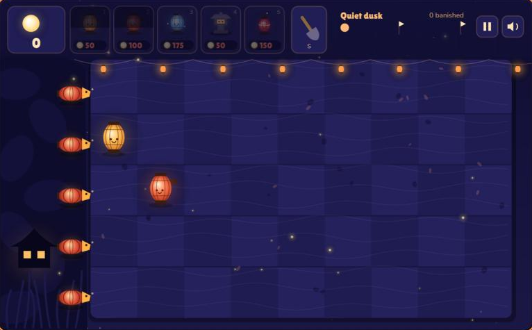

# Lanternwall

A lane-defense game set in a paper-lantern night garden. Shadows creep in from the dark across five lanes; plant lanterns to stop them before they reach the teahouse. Hold out for 10 nights to win, then keep going in endless mode.

The whole game is one file, `lanternwall.html`: a canvas game with no build step and no dependencies beyond two Google Fonts.

Source: https://github.com/aapostoliadis/lanternwall

Play online: https://claude.ai/artifact/Qp55iLb15FiPoDh3VuwAjy



## Play

Open `lanternwall.html` in a browser, or serve the folder:

```bash
python -m http.server 8765
```

then visit http://localhost:8765/lanternwall.html.

## How to play

Pick a lantern card, then click a tile to plant it. Fireflies drift down and rise from firefly lanterns; tap them to collect light, which pays for lanterns.

| Lantern | Cost | Role |
| --- | --- | --- |
| Firefly Lantern | 50 | Gathers light |
| Ember Lantern | 100 | Shoots sparks down its lane |
| Frost Lantern | 175 | Shoots sparks that chill and slow |
| Stone Lantern | 50 | Tough wall that holds shadows back |
| Firecracker | 150 | Bursts, banishing nearby shadows |

### Keys

| Key | Action |
| --- | --- |
| `1`–`5` | Select a lantern |
| `S` | Shovel (remove a lantern) |
| `P` | Pause |
| `Esc` | Cancel selection |

The game pauses on its own when the window loses focus.

## Files

| File | What it is |
| --- | --- |
| `lanternwall.html` | The game |
| `screenshot.png` | The gameplay screenshot shown above |
| `lanternwall.orig.html` | Backup from before the lantern restyle |
| `lanternwall_check.js` | The game's script, extracted for `node --check` |
| `lanternwall_css.txt`, `lanternwall_world.js` | Extracted CSS and world-drawing segments used while restyling |
| `lanternwall_restyle_hud.py`, `lanternwall_rewording.py` | One-off scripts that applied the restyle and the lantern wording; already applied, so re-running them edits the game again |

## License

MIT. See [LICENSE](LICENSE).
